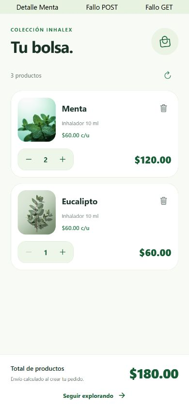
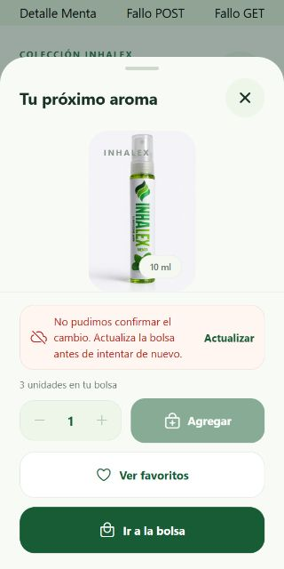

# Bolsa de compras: criterios de Trello

Revisión del **12 de octubre de 2026**, en la rama `mobile/zenaida-bolsa`. Corresponde a la tarjeta «Bolsa de compras» asignada a Zenaida. Actividad desarrollada con asistencia de Codex; este registro no modifica Trello ni crea un commit.

## Alcance

Agregar aromas desde el detalle, consultar la bolsa, ajustar cantidades y quitar productos. La API existente guarda la bolsa de la cuenta autenticada y confirma los precios y totales. La creación y confirmación de pedidos corresponde a otra actividad.

| Criterio | Estado | Evidencia |
| --- | --- | --- |
| Agregar productos a la bolsa | Implementado y revisado en web | Selector de cantidad y botón en el detalle compartido por Inicio, Catálogo, Favoritos y Bolsa. `POST /cart`. |
| Mostrar los productos agregados | Implementado | `CartScreen` con imagen, nombre, presentación, precio unitario, cantidad y subtotal; contador en la pestaña Bolsa. |
| Modificar la cantidad | Implementado y revisado en web | Controles de aumentar/reducir y `PATCH /cart/:productId`; se espera la confirmación del servidor. |
| Eliminar productos | Implementado y revisado en web | Botón de quitar y `DELETE /cart/:productId`, hasta llegar al estado vacío. |
| Calcular el total | Implementado; contrato cubierto | Se validan y muestran subtotales y total de productos confirmados por la API. No se mezclan monedas ni se anticipa un total durante una escritura. |
| Evitar cantidades inválidas | Implementado y probado | Enteros de 1 a 25, límite acumulado e inventario conocido; contempla pedidos pendientes de stock. Se permite reducir o quitar una cantidad previamente guardada que exceda el inventario actual. |
| Mantener actualizada la bolsa | Implementado; API autenticada real pendiente | `GET /cart` al montar el proveedor por usuario y al entrar en Bolsa; actualización manual y al deslizar. Las operaciones comparten el estado con el detalle y el contador. |
| Manejar errores de conexión | Implementado y revisado | Conserva la última bolsa confirmada y muestra reintento. Tras un cambio de resultado incierto exige una lectura correcta antes de enviar otra escritura. |
| Probar funcionalidad | Automatizado y web completados; teléfono pendiente | 37 pruebas de Bolsa y 50 regresiones de Catálogo/Favoritos. Recorrido con componentes reales y repositorio simulado. |
| Revisar código | Completado | TypeScript y lint limpios; Expo Doctor 21/21; revisión independiente de sesión, concurrencia, inventario y totales. |

## Arquitectura y comportamiento

- Ruta delgada, vista, ViewModel/controlador, repositorio, adaptador HTTP y mapper separados; reutiliza el cliente HTTP y la sesión. Sin dependencias adicionales.
- El proveedor se monta dentro del árbol identificado por usuario. Las operaciones obsoletas se invalidan al desmontar o cambiar de cuenta; el adaptador comprueba la vigencia antes y después de leer el token.
- Lecturas y escrituras se serializan porque la API reemplaza el arreglo completo de la bolsa. Los toques repetidos sobre el mismo aroma no envían cambios duplicados.
- Agregar es una operación incremental. Si la respuesta se pierde, el servidor pudo haber aplicado el cambio: se bloquean nuevas escrituras y se descartan las aún no enviadas hasta reconciliar mediante `GET /cart`. El reintento visible actualiza, no vuelve a agregar automáticamente.
- Las adiciones respetan el límite más restrictivo entre el detalle y los metadatos de la bolsa, además de la cantidad ya guardada. La revisión corrigió el caso de una bolsa con stock anterior y un detalle recién consultado sin disponibilidad.
- Los precios de la bolsa proceden de la respuesta de la API, incluyendo sus promociones. El precio unitario se deriva del subtotal confirmado de cada línea; no se reemplaza por el precio mostrado por el catálogo.
- La validación de inventario aquí es del cliente y no reserva existencias. La API actual de bolsa no impone stock; la validación final al crear un pedido sigue correspondiendo al flujo de pedidos. No se modificó el servidor.
- Se conservan los cinco tabs, las fotografías y los colores de INHALEX. Controles accesibles de al menos 44 px, indicadores de espera y transiciones existentes con movimiento reducido.

## Validación ejecutada

```bash
npm run typecheck
npm run lint
node --test scripts/cart-*.test.cjs scripts/favorites-*.test.cjs scripts/catalog-*.test.cjs
npm run doctor
```

Resultados: **87/87 pruebas aprobadas**, TypeScript y lint sin errores, **21/21 comprobaciones de Expo** aprobadas.

Revisión web a **390 × 844** y **320 × 640**, usando `CartProvider`, `CartContent`, `CartItemCard`, `QuantityStepper`, `AddToBagControls` y `ProductDetails` reales con un repositorio de ejemplo. Sin credenciales ni cambios de datos reales:

- Dos aromas, tres unidades y total de $180; aumentar Menta actualiza a $240 y después a $300. El control se bloquea al alcanzar las cuatro unidades disponibles del ejemplo.
- Reducir cantidad y agregar desde el detalle con selector de unidades.
- Simular una adición aplicada cuya respuesta falla: la app conserva el último total, bloquea cambios y muestra «Actualizar». La lectura recupera la cuarta unidad sin duplicarla.
- Pie del detalle accesible a 320 px, incluso con aviso de conexión y controles de cantidad.
- Quitar ambos aromas, mostrar estado vacío y recuperar un fallo al actualizar esa lista vacía.
- Agregar dos unidades desde el detalle de nuevo y verificar dos unidades y total de $120.
- Sin errores de consola durante el recorrido. Los controles «Detalle Menta», «Fallo POST» y «Fallo GET» de las capturas pertenecen exclusivamente a la revisión temporal, eliminada al terminar.






## Pendiente en Expo Go y con la API real

Con una cuenta de prueba: agregar desde Inicio/Catálogo/Favoritos, comprobar el contador de la pestaña, cambiar cantidades, quitar, cerrar y volver a iniciar sesión para verificar persistencia y cambiar de cuenta para verificar aislamiento. Probar también pérdida de conexión, precios e inventario actualizados, deslizamiento para refrescar, regreso del detalle, texto grande y lector de pantalla. Las pruebas físicas siguen pospuestas según lo acordado con David. La revisión web de componentes no sustituye una sesión autenticada contra el servidor ni la navegación nativa.
