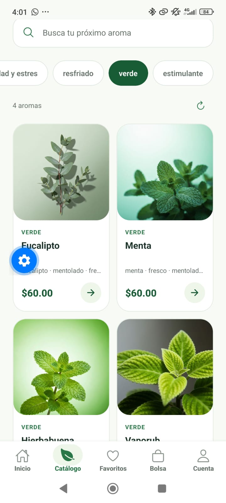
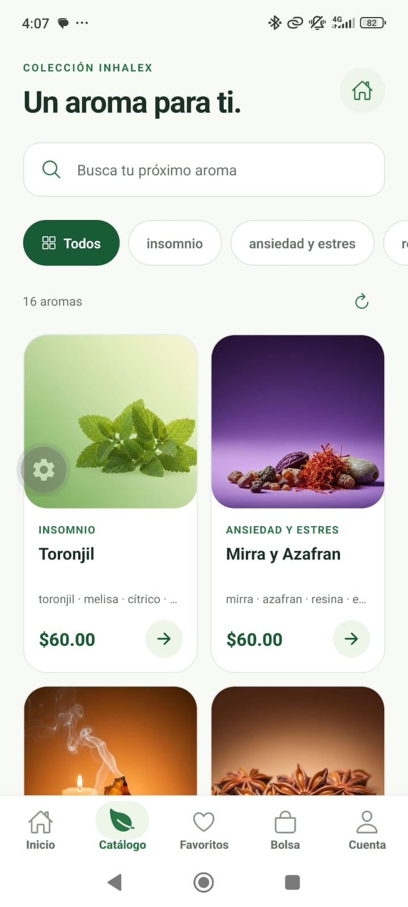

# Catálogo de productos: criterios de Trello

Revisión del **7 de octubre de 2026** en `Mobile/inhalex-app`. Esta evidencia corresponde a la tarjeta «Catálogo de productos» de la captura; no modifica el tablero.

| Criterio | Estado | Evidencia |
| --- | --- | --- |
| Diseñar pantalla del catálogo | Implementado | [CatalogScreen](../src/features/catalog/presentation/screens/CatalogScreen.tsx): `FlatList`, márgenes y columnas adaptables, búsqueda y filtros. Tarjetas redondeadas, entradas suaves, pulsaciones y skeleton que respetan movimiento reducido. |
| Obtener productos desde la API | Verificado | [ProductsApiAdapter](../src/features/catalog/data/adapters/ProductsApiAdapter.ts), [HttpCatalogRepository](../src/features/catalog/data/repositories/HttpCatalogRepository.ts) y [catalogDependencies](../src/features/catalog/data/catalogDependencies.ts): GET públicos e inyección de dependencias. API local: 16 productos y 5 líneas. |
| Mostrar nombre, imagen, precio y datos principales | Implementado | [ProductCard](../src/features/catalog/presentation/components/ProductCard.tsx): nombre, imagen principal, línea, notas y precio de la API; promoción/disponibilidad cuando corresponden. [catalogMapper](../src/features/catalog/data/mappers/catalogMapper.ts) valida y normaliza datos. |
| Manejar estado de carga | Verificado | [CatalogState](../src/features/catalog/presentation/components/CatalogState.tsx) muestra skeleton. [CatalogController](../src/features/catalog/presentation/viewModels/CatalogController.ts) separa carga de productos, categorías, recarga y detalle. |
| Mostrar mensaje cuando no existan productos | Verificado | Estado vacío distingue «Sin coincidencias» de catálogo sin productos; ofrece «Ver todos» o «Actualizar catálogo». `resetFilters` limpia búsqueda y línea de forma atómica. |
| Manejar errores de conexión | Verificado | Error inicial con «Reintentar»; recarga fallida conserva productos vigentes con aviso. Sin productos, un fallo de recarga pasa a error. Las categorías pueden fallar sin bloquear productos. |
| Verificar navegación al detalle del producto | Verificado | Tarjeta abre [ProductDetails](../src/features/catalog/presentation/components/ProductDetails.tsx) y consulta GET `/products/:slug`. El detalle conserva datos al fallar, permite reintentar y no reaparece por respuestas tardías tras cerrarlo. |
| Probar la funcionalidad | Verificado en pruebas y navegador; Android parcial | 28 casos automatizados: 19 Controller + 6 datos + 3 fotografías. Navegador con componentes reales/API pública y fallos temporales; exportación Android Hermes correcta. El 9 de octubre, David y Zenaida confirmaron en Android la selección de Verde y sus cuatro aromas; el resto del recorrido físico sigue pendiente. |
| Revisar el código | Revisado | MVVM con controlador observable, hook de suscripción, Repository, Adapter, Mapper y composición de dependencias. TypeScript y lint sin errores; pruebas de carreras de requests y stop/restart. |

## Verificación reproducible

```bash
node --test scripts/catalog-controller.test.cjs scripts/catalog.test.cjs scripts/aroma-images.test.cjs
npm run typecheck
npm run lint
```

El Controller prueba estados, debounce de 280 ms, cambios de filtro, respuestas fuera de orden, recargas simultáneas, detalle y desmontaje/reinicio. Las pruebas de datos comprueban promociones, transporte inyectado, mapeo, búsqueda literal y propagación de errores. Las de imágenes evitan seleccionar un frasco incorrecto por notas aromáticas compartidas.

## Alcance y pendientes

El cliente conserva el límite existente de **100 productos por consulta**, en la primera página; no incorpora paginación nueva. Los 16 productos actuales caben en ese límite. La API también respondió correctamente a una búsqueda sin resultados, al filtro de línea verde, a una página posterior de prueba y a un detalle inexistente con HTTP 404.

**Romero tiene imagen principal de catálogo, pero falta la fotografía de su frasco** en `Client/public/aromas`. El detalle comunica esa ausencia sin reemplazarla con otro producto. Las otras fotografías del frasco mantienen proporción y producto completo.

La validación inicial se hizo en navegador, con tamaños móviles y componentes de producción; los fallos se inyectaron temporalmente para revisar recuperación. La exportación del bundle Android con Expo Router y Hermes `.hbc` finalizó correctamente. La comprobación física de Android comenzó el 9 de octubre y se registra abajo. No se publicó la app en Play Store.

## Seguimiento de categorías en Android: 9 de octubre de 2026

Rama de trabajo: `mobile/zenaida-categorias`. David y Zenaida reportaron el resultado de la prueba en un teléfono Android con Expo Go. Este registro, preparado con asistencia de Codex, documenta esa comprobación; la implementación del filtro ya formaba parte de la base integrada.

| Comprobación | Resultado reportado | Evidencia |
| --- | --- | --- |
| Seleccionar Verde | Confirmado | El filtro queda resaltado y la pantalla muestra «4 aromas». |
| Mostrar productos de la línea seleccionada | Confirmado | Eucalipto, Menta, Hierbabuena y Vaporub, con etiqueta Verde. |
| Volver a Todos | Confirmado | La captura muestra Todos resaltado, «16 aromas» y productos de distintas líneas. David y Zenaida confirmaron la recuperación del catálogo completo. |
| Desplazar el catálogo | Confirmado según el reporte | David y Zenaida indicaron que la vista se desplaza bien. |
| Probar otras líneas | Pendiente | Confirmar selección y productos de cada línea. |
| Abrir y cerrar el detalle desde una línea | Pendiente | Confirmar navegación y conservación del filtro. |
| Revisar estado sin coincidencias | Pendiente | Probar una búsqueda sin resultados dentro de una línea y recuperar la colección. |
| Revisar error y reintento en el teléfono | Pendiente | Confirmar el recorrido de recuperación en Android. |





Las capturas y los resultados comunicados confirman los pasos marcados en la tabla; no se registra como aprobado el recorrido completo ni se atribuye nuevamente la implementación previa.

Como contraste independiente, el 9 de octubre se consultaron los GET públicos de la API local: `/products/categories`, `/products?category=linea-verde&page=1&limit=100` y `/products?page=1&limit=100`. Verde devuelve los mismos cuatro productos y sus identificadores coinciden con el subconjunto Verde del catálogo completo. La API devuelve 16 productos en total y cinco líneas: Insomnio (2), Ansiedad y estrés (4), Resfriado (4), Verde (4) y Estimulante (2). Estos conteos son la referencia para las siguientes pruebas del teléfono, no una confirmación de que esas pruebas manuales ya se hayan realizado.

## Desarrollo del selector de líneas: 9 de octubre de 2026

Cambios nuevos en `mobile/zenaida-categorias`, preparados con asistencia de Codex para continuar la tarjeta «Líneas o categorías». La consulta a la API y el filtro compartido pertenecen a la base; esta mejora se concentra en su presentación en Inicio y Catálogo.

- [CategoryChips](../src/features/catalog/presentation/components/CategoryChips.tsx) reutiliza el mismo selector en ambas vistas. Muestra placeholders durante la carga inicial de líneas y conserva las categorías existentes durante una actualización.
- La línea seleccionada permanece visible al cambiar de selección, regresar a la pestaña o cambiar el ancho de la pantalla. El desplazamiento se limita a lo necesario y una actualización no interrumpe el desplazamiento manual del selector.
- Los botones tienen entrada suave, respuesta a la pulsación y un área táctil mínima de 44 puntos. La entrada y el desplazamiento animado respetan movimiento reducido; los lectores de pantalla reciben el estado seleccionado y el estado de carga.
- [CatalogScreen](../src/features/catalog/presentation/screens/CatalogScreen.tsx) y [HomeScreen](../src/features/home/presentation/screens/HomeScreen.tsx) comunican su estado de foco al selector y cierran el teclado al seleccionar una línea.

**Comprobación de código:** `npm run typecheck` y `npm run lint` finalizaron sin errores. Revisión adicional del componente sin bloqueos. No se añadieron dependencias.

**Pendiente:** revisar estas mejoras en Expo Go. Las capturas de la sección anterior corresponden al recorrido previo a estos cambios; las pruebas manuales restantes se pospusieron a petición de David.
