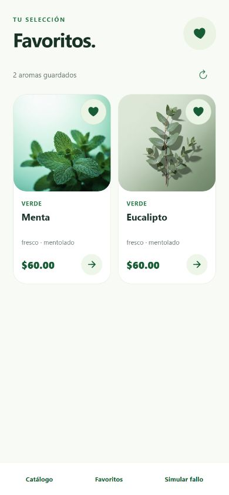
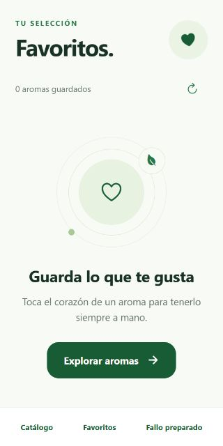

# Favoritos: criterios de Trello

Revisión del **12 de octubre de 2026**, en la rama `mobile/zenaida-favoritos`. Corresponde a la tarjeta «Favoritos» asignada a Zenaida. Desarrollo con asistencia de Codex; este registro no modifica Trello ni crea un commit.

## Alcance

Guardar y quitar productos desde Inicio, Catálogo y el detalle; consultar la selección en la pestaña Favoritos. La persistencia utiliza la API existente y la cuenta autenticada. Bolsa de compras conserva su alcance independiente.

| Criterio | Estado | Evidencia |
| --- | --- | --- |
| Agregar opción para marcar un producto | Implementado | `FavoriteButton` aparece en tarjetas y detalle, con estado seleccionado, etiqueta accesible e indicador durante la operación. |
| Guardar el producto en favoritos | Implementado; contrato cubierto por pruebas | `PUT /favorites/:productId`, con token de la sesión actual. La interfaz confirma el guardado después de la respuesta. |
| Mostrar lista de productos favoritos | Implementado | `FavoritesScreen` reemplaza la pantalla provisional y permite abrir el detalle. Una columna en pantallas compactas o con texto grande; dos en tamaños mayores. |
| Eliminar productos de favoritos | Implementado; contrato cubierto por pruebas | `DELETE /favorites/:productId`. Un fallo conserva el producto y permite volver a pulsar el corazón. |
| Sincronizar favoritos con la API | Implementado; verificación autenticada real pendiente | `GET /favorites` al iniciar la sesión de navegación y al entrar en Favoritos; actualización manual y al deslizar. Inicio, Catálogo y detalle comparten el estado. |
| Mostrar mensaje sin favoritos | Implementado y revisado en web | Estado vacío con «Explorar aromas». Los errores de carga inicial se muestran como errores, no como una colección vacía. |
| Manejar errores de conexión | Implementado y revisado | Reintento de lectura, mensajes controlados y conservación de la última lista tras un fallo de actualización, incluso cuando estaba vacía. |
| Probar funcionalidad | Pruebas automatizadas y revisión web completadas; teléfono pendiente | 31 pruebas nuevas de Favoritos y 19 regresiones del controlador del catálogo aprobadas. Recorrido web con componentes reales y repositorio simulado. |
| Revisar código | Completado | TypeScript y lint sin errores ni advertencias; Expo Doctor 21/21; revisión adicional de concurrencia, sesión y separación de botones. |

## Arquitectura y comportamiento

- Rutas delgadas y capas separadas: vista, ViewModel/controlador, repositorio y adaptador HTTP. Se reutilizan el cliente HTTP, la sesión y el mapper del catálogo; no se añaden dependencias.
- El proveedor se crea por usuario autenticado. Al desmontar o cambiar de cuenta se invalidan las operaciones pendientes; el adaptador comprueba la validez antes y después de leer el token.
- Lecturas y escrituras se serializan. Los toques repetidos sobre el mismo producto no generan operaciones duplicadas, y una lectura antigua no revierte una escritura confirmada.
- Se mantiene el orden devuelto por la API y se eliminan duplicados. Los mensajes de error no exponen respuestas técnicas del servidor.
- El corazón de una tarjeta es un botón separado del acceso al detalle. En el detalle, guardar/quitar y «Ver favoritos» conservan funciones distintas.
- Fotografías, colores y cinco pestañas de INHALEX conservados. Se reutilizan transiciones y controles que respetan movimiento reducido.

## Validación ejecutada

```bash
npm run typecheck
npm run lint
node --test scripts/favorites-controller.test.cjs scripts/favorites-repository.test.cjs scripts/catalog-controller.test.cjs
npm run doctor
```

Resultados: **50/50 pruebas aprobadas**, TypeScript y lint limpios, **21/21 comprobaciones de Expo** aprobadas.

Revisión web aislada a **390 × 844** y **320 × 640**, con `FavoritesProvider`, `FavoritesContent`, `FavoriteButton`, `ProductCard` y `ProductDetails` reales. Se inyectó un repositorio de ejemplo con retrasos y fallos controlados, sin credenciales ni modificaciones de datos reales:

- Lista con dos productos; quitar ambos hasta mostrar el estado vacío.
- Guardar desde una tarjeta sin abrir el detalle y comprobar el corazón al abrirlo después.
- Quitar desde el detalle y abrir Favoritos mediante su acceso existente.
- Fallo al guardar: el corazón permanece sin marcar; el siguiente intento confirma el guardado.
- Fallo al actualizar una colección vacía: aviso visible y recuperación con «Reintentar».
- Diseño sin recortes horizontales en ambos tamaños. La vista temporal se eliminó después de la revisión.





## Pendiente en Expo Go y con la API real

Guardar y quitar con una cuenta de prueba; cerrar y volver a iniciar sesión para verificar persistencia; comprobar aislamiento al cambiar de usuario, pérdida de conexión, regreso desde el detalle, lector de pantalla y texto grande. Las pruebas físicas permanecen pospuestas según lo acordado con David. La revisión web valida componentes y callbacks, no sustituye la navegación nativa ni una sesión autenticada contra el servidor.
