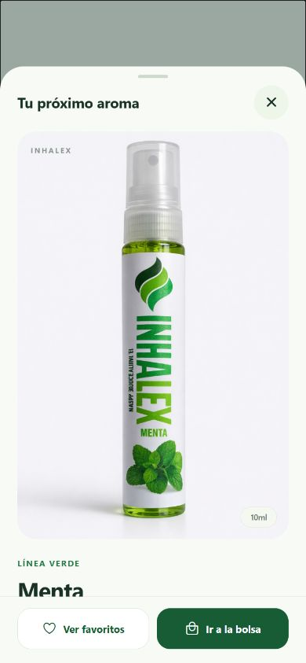
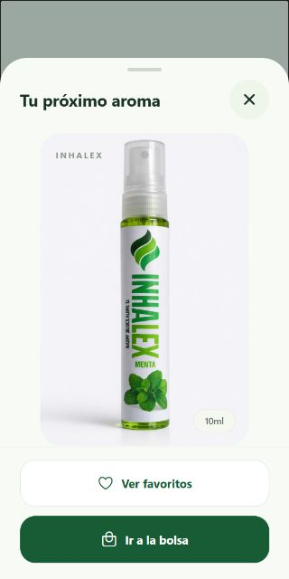

# Detalle de producto: criterios de Trello

Revisión del **12 de octubre de 2026**, en la rama `mobile/zenaida-detalle`. Corresponde a la tarjeta «Detalle de producto» compartida por David; este registro no modifica Trello.

## Alcance

La pantalla, la consulta del detalle y su información ya pertenecen a la base integrada. Este cambio añade **accesos de navegación** a las pestañas existentes de Favoritos y Bolsa. El guardado de favoritos, las cantidades y la incorporación de productos a la bolsa corresponden a sus propias tarjetas.

| Criterio | Estado | Evidencia |
| --- | --- | --- |
| Crear pantalla de detalle | Implementado en la base | [ProductDetails](../src/features/catalog/presentation/components/ProductDetails.tsx) conserva el panel con imagen, categoría y descripción. |
| Obtener información del producto seleccionado | Implementado en la base | [CatalogController](../src/features/catalog/presentation/viewModels/CatalogController.ts) consulta `findProduct`, mantiene el producto seleccionado y descarta respuestas tardías tras cerrar. |
| Mostrar nombre, descripción, precio e imagen | Implementado; imagen adaptada al nuevo pie | [ProductBottleImage](../src/features/catalog/presentation/components/ProductBottleImage.tsx) conserva la proporción de la fotografía y ajusta su altura al espacio disponible para mostrar el frasco completo. |
| Mostrar información adicional disponible | Implementado en la base | Perfil aromático, presentación, origen y beneficios cuando existen. |
| Agregar acceso a favoritos | Implementado en este cambio | «Ver favoritos» solicita el cierre del panel y después navega a `/(tabs)/favoritos`. |
| Agregar acceso a bolsa de compras | Implementado en este cambio | «Ir a la bolsa» solicita el cierre del panel y después navega a `/(tabs)/bolsa`. |
| Manejar errores al cargar el producto | Implementado en la base | Aviso de fallo, conservación de la información y «Reintentar». Los accesos de navegación siguen disponibles. |
| Probar la funcionalidad | Revisión web parcial; Android pendiente | Se revisaron el diseño y los callbacks de cierre/acceso con componentes reales y datos de ejemplo. El recorrido completo en Expo Go sigue pendiente. |
| Revisar el código | Revisado | TypeScript y lint sin errores. Revisión adicional de cierre, cancelación, movimiento reducido y adaptación del pie. |

## Cambios nuevos

- [ProductDetailActions](../src/features/catalog/presentation/components/ProductDetailActions.tsx) presenta dos botones discretos al pie del panel. Se apilan en pantallas menores de 360 puntos o con escala de texto superior a 1,2; tienen etiquetas accesibles y una altura mínima de 52 puntos.
- [BottomSheet](../src/shared/components/BottomSheet.tsx) conserva el pie fuera del contenido desplazable y respeta el área segura. Los accesos usan su mismo cierre animado; el callback se consume una vez, incluso con pulsaciones rápidas o al activar movimiento reducido durante el cierre. Ocultar o desmontar el panel cancela una acción pendiente.
- La navegación pertenece a `CatalogProductOverlay`, mientras el detalle recibe callbacks. El controlador cierra e invalida el request de detalle antes de navegar; el filtro del catálogo se conserva.
- La fotografía ajusta ambas dimensiones en conjunto según la altura real del contenido. Su fondo sigue ocupando todo el marco, sin recortar ni deformar el frasco.

## Evidencia de revisión

Se usó una vista temporal aislada con `ProductDetails`, `BottomSheet`, `ProductDetailActions` y las pantallas actuales de Favoritos y Bolsa. Se suministraron datos de ejemplo de Menta y callbacks controlados; **no se usó autenticación, ni se verificó aquí la navegación real de Expo Router en Android**. La vista temporal se eliminó al terminar.

- En 390 × 844, los accesos quedan en una fila.
- En 320 × 640, quedan apilados y el frasco completo cabe en el área visible de la foto.
- Cada acceso produjo un cierre y una ejecución de su callback; después se mostró la pantalla correspondiente en la vista aislada.
- `npm run typecheck` y `npm run lint` finalizaron correctamente.

Pendiente en Expo Go: abrir el detalle desde Inicio y Catálogo, recorrer ambos accesos, comprobar el botón Atrás y la conservación del filtro, y revisar texto grande y errores/reintento en el teléfono. Las pruebas físicas continúan pospuestas según lo acordado con David.
