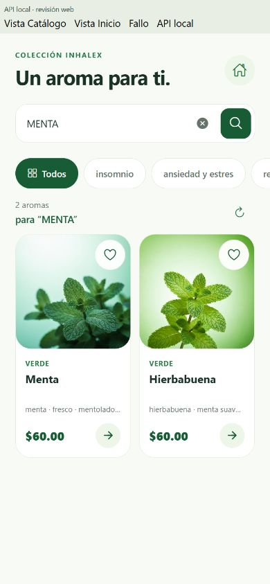
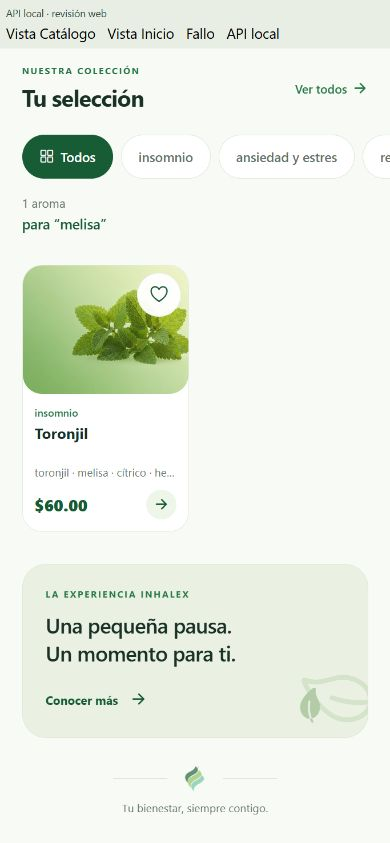
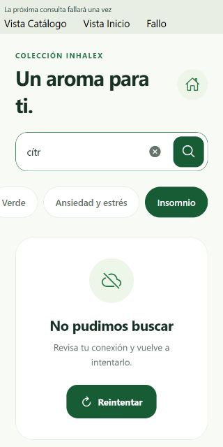

# Búsqueda de productos

Trabajo de **David**, con asistencia de Codex, en `mobile/david-busqueda`. Revisión del **12 de octubre de 2026**. El campo, la integración pública con la API y los filtros compartidos ya pertenecían a la base móvil; esta entrega completa su interacción y la evidencia de la tarjeta.

## Cambios de esta entrega

- Buscar mediante botón o tecla del teclado envía la consulta inmediatamente. Repetir la acción reutiliza la solicitud vigente y no duplica una consulta que ya terminó correctamente.
- Al editar, los productos anteriores desaparecen desde el primer cambio; se muestra carga durante los 280 ms de espera y la consulta. Las respuestas anteriores no sustituyen resultados nuevos.
- Limpiar consulta inmediatamente, conservando la línea. «Ver todos» en el estado vacío limpia texto y línea juntos.
- Inicio y Catálogo muestran el término, las coincidencias y mensajes contextualizados de vacío/error. Inicio desplaza a los resultados al enviar.
- Las cantidades indican «Mostrando X de Y» si la vista presenta menos tarjetas que coincidencias. Se conserva el límite de 100 productos de Catálogo y seis destacados en Inicio.

## Criterios de la tarjeta

| Criterio | Estado y evidencia |
| --- | --- |
| Agregar campo de búsqueda | Campo compartido existente en [CatalogSearch](../src/features/catalog/presentation/components/CatalogControls.tsx), con botón Buscar nuevo, etiqueta accesible y acciones de 44 puntos. |
| Capturar texto ingresado | Estado controlado en [CatalogController](../src/features/catalog/presentation/viewModels/CatalogController.ts). Conserva el texto visible y elimina espacios externos al consultar. |
| Consultar o filtrar productos | [ProductsApiAdapter](../src/features/catalog/data/adapters/ProductsApiAdapter.ts) y Repository existentes. Búsqueda literal combinada con línea, envío inmediato y debounce al escribir. |
| Mostrar resultados coincidentes | Verificado en Inicio y Catálogo con componentes reales y la API local pública. Contador y término de la consulta en ambas vistas. |
| Mostrar mensaje cuando no existan resultados | [CatalogState](../src/features/catalog/presentation/components/CatalogState.tsx): «Sin coincidencias», término y línea, con recuperación mediante «Ver todos». |
| Manejar errores de búsqueda | «No pudimos buscar» y Reintentar; el reintento conserva texto/línea. Fallo temporal inyectado y recuperación comprobados en navegador; carreras y errores cubiertos por pruebas. |
| Probar diferentes términos | Pruebas automatizadas, GET públicos de la API local y revisión web descritos abajo. **Pendiente el recorrido en Expo Go/Android físico.** |
| Revisar el código | Revisión adicional del controlador y las vistas sin bloqueos. TypeScript, lint y Expo Doctor aprobados. |

## Validación

**110 pruebas automatizadas aprobadas:** 42 de catálogo (28 controlador, 11 datos, 3 imágenes), 31 favoritos y 37 bolsa. Se añadieron 14 casos de búsqueda: 9 del controlador y 5 de datos. Incluyen envío inmediato, consultas repetidas, espacios, limpieza durante debounce, reintento, respuestas tardías, símbolos de expresiones regulares, caracteres reservados URL y Unicode. La prueba que simula el filtrado de la API está identificada como simulación del contrato.

```bash
node --test scripts/catalog-controller.test.cjs scripts/catalog.test.cjs scripts/aroma-images.test.cjs scripts/favorites-controller.test.cjs scripts/favorites-repository.test.cjs scripts/cart-controller.test.cjs scripts/cart-repository.test.cjs
npm run typecheck
npm run lint
npm run doctor
```

TypeScript y lint sin errores; Expo Doctor **21/21**. Sin dependencias nuevas.

GET de solo lectura a `http://localhost:3200/api/products`, primera página, límite 100:

| Término | Línea | Resultado observado |
| --- | --- | --- |
| `MENTA` | Todas | 2: Menta y Hierbabuena; esta última incluye «menta suave» en sus notas. |
| `ment` | Todas | 16: el fragmento también puede estar en las descripciones. |
| `melisa` | Todas | 1: Toronjil. |
| `zzsincoincidenciaszz` | Todas | 0. |
| `[a+b]` | Todas | 0; se interpreta como texto literal. |
| `cítr` | Todas | 1: Toronjil. |
| `citr` | Todas | 0; el contrato actual distingue acentos. |
| `Menta` | Verde | 2: Menta y Hierbabuena. |
| `Menta` | Insomnio | 0. |

La API busca en nombre, descripción, descripción larga y notas aromáticas; no divide la frase en palabras independientes. Respeta los espacios internos y acentos, e ignora mayúsculas. Estos resultados son una observación del 12 de octubre, no un conjunto fijo de productos.

## Revisión visual

Componentes reales con inyección de dependencias temporal. Revisión a 390 × 844 y 320 × 640: envío con Enter y botón, carga sin resultados anteriores, conservación del término entre Inicio/Catálogo, vacío por texto + línea, limpieza conservando línea, recuperación con «Ver todos» y error con reintento. La comprobación de errores usó productos y fallos simulados; las búsquedas normales se verificaron también con la API real local.

La vista web con API real se ejecutó en `localhost:8081`, permitido por la configuración CORS existente. `localhost:8082` no tenía ese permiso; no se modificó el servidor. Las entradas temporales de revisión se retiraron al terminar.








## Pendiente en dispositivo

Mantener la tarjeta en **En revisión / pruebas** hasta verificar el teclado Buscar, escritura rápida, cambio de pestaña/línea, limpieza y reintento con conexión interrumpida en Expo Go. Las pruebas web y automatizadas no confirman todavía ese recorrido físico. No se modificó Trello ni se creó un commit/PR automáticamente.
