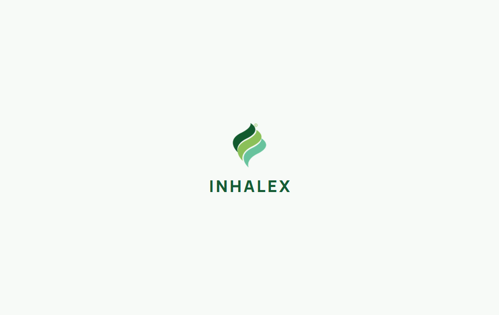
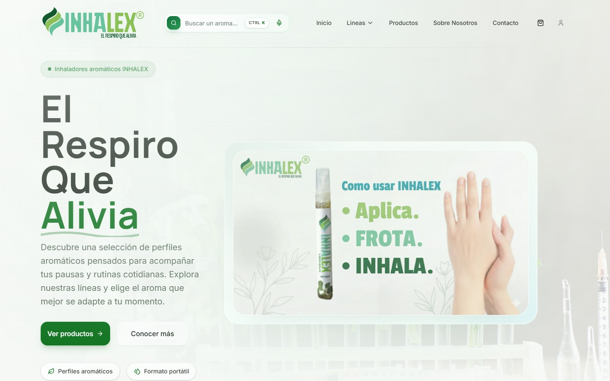
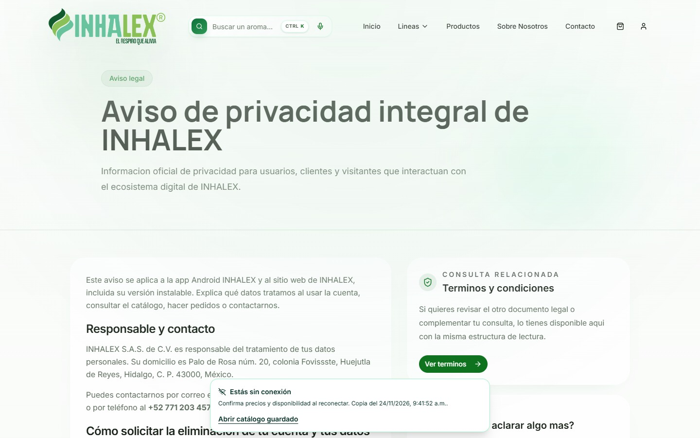
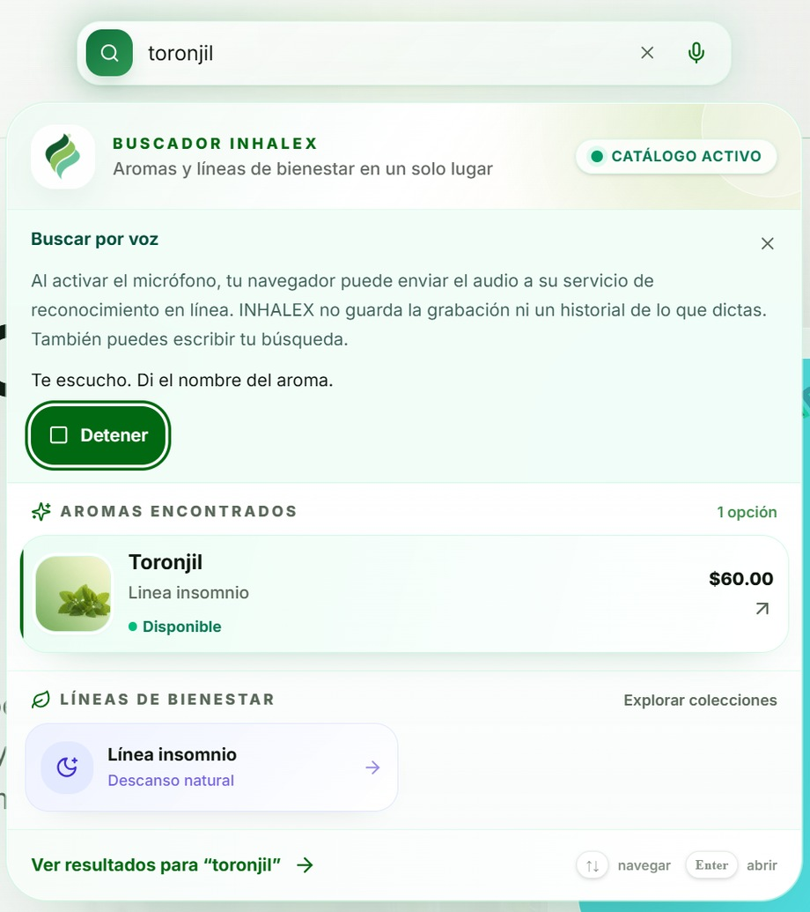

# Actividad 9-2 PWA de INHALEX

INHALEX es una aplicación web progresiva para explorar inhaladores aromáticos, consultar el catálogo y acceder a información de ayuda. El caso de estudio combina una interfaz Next.js con una API NestJS y datos persistidos en MongoDB.

- [Rama de entrega con el código fuente](https://github.com/David567rs/Proyecto-INHALEX/tree/codex/actividad-9-2-pwa)
- [Aplicación pública](https://proyecto-inhalex.vercel.app/)
- [Guía de instalación](https://proyecto-inhalex.vercel.app/instalar)
- [Manual técnico y de pruebas](pwa-implementation.md)

## Requisitos y ubicación en el código

| Requisito | Implementación en INHALEX | Cómo se comprueba |
| --- | --- | --- |
| Splash e Inicio | [Proveedor de la PWA](../Client/components/pwa/pwa-provider.tsx) y [estilos de arranque](../Client/components/pwa/pwa-launch.module.css). La pantalla de marca aparece en los primeros instantes de la ruta `/` al abrir en modo instalado (`standalone`). Se retira al hidratar la página o se oculta cerca de los 1.5 segundos si la hidratación tarda. [Inicio](../Client/app/page.tsx) presenta la portada y el catálogo. | Capturas 1 y 2. El [manifiesto](../Client/app/manifest.ts) declara la ruta de arranque, el modo de pantalla y los iconos. |
| Vista del cliente (CSR) | [Inicio](../Client/app/page.tsx) solicita el catálogo desde un efecto de React. El [proveedor](../Client/components/products/catalog-provider.tsx) trae aromas y categorías y actualiza el estado. [El catálogo](../Client/components/products/products-catalog-page.tsx) aplica los filtros en el navegador. | En `/productos`, seleccionar una línea y observar el cambio de resultados. El HTML inicial de Inicio ya incluye el título y el estado de carga del catálogo. |
| Vista del servidor (SSR) | El [detalle de producto](../Client/app/productos/%5Bslug%5D/page.tsx) declara `force-dynamic` y obtiene los datos mediante una [consulta desde el servidor](../Client/lib/products/products-server.ts) con `cache: "no-store"`. | El HTML real de [Toronjil](https://proyecto-inhalex.vercel.app/productos/toronjil) incluye el nombre y el precio en el contenido que entrega el servidor. |
| Datos locales y remotos | El [carrito](../Client/components/cart/cart-provider.tsx) conserva sus artículos en `localStorage`. El [controlador de productos](../Server/src/modules/products/products.controller.ts) expone la API y el [módulo principal](../Server/src/app.module.ts) conecta NestJS con MongoDB mediante Mongoose. | Consultar el [catálogo de la API](https://inhalex-backend.onrender.com/api/products?limit=2&page=1) y revisar el nombre de la clave `inhalex-cart-v1` en el código. |
| Datos offline | El [service worker](../Client/pwa/service-worker.js) descarga respuestas públicas y recursos en Cache Storage. Una visita a Inicio prepara [ocho rutas](../Client/pwa/public-pages.mjs) y escribe el marcador `/__pwa/pages-ready` cuando termina. | Captura 3. Tras completar la descarga, desactivar la red en el perfil de prueba y abrir las ocho rutas. Los pedidos requieren conexión. |
| Notificaciones | [Mi cuenta](../Client/components/notifications/push-preferences.tsx) solicita el consentimiento para Web Push. La [API](../Server/src/modules/notifications/web-push.controller.ts) guarda la suscripción de la cuenta y el [worker](../Client/pwa/service-worker.js) recibe el aviso. | Configuración pública habilitada y pruebas automatizadas del flujo. La recepción en el dispositivo se comprueba con la prueba manual descrita abajo. |
| Elemento físico | El [buscador por voz](../Client/components/search/voice-product-search.tsx) usa el micrófono mediante [SpeechRecognition](../Client/lib/voice/product-voice-search.ts), en español de México y tras una acción explícita. La frase se convierte en texto para buscar un aroma. | La prueba física dictó «toronjil» y el buscador mostró el producto. Véase la captura 4. |

## Resultados del 24 de noviembre de 2026

- **Aplicación publicada.** Se prepararon automáticamente las ocho vistas desde Inicio. En una sesión aislada de Chrome, las ocho respondieron desde el service worker con la conexión desactivada. La configuración pública de Web Push en producción devolvió `enabled: true`. Se comprobó la lectura del catálogo desde la API.
- **Micrófono físico.** En Chrome sobre la web publicada, la consulta por voz «toronjil» mostró una coincidencia. En otro intento, el reconocimiento interpretó «lavanda» como «la banda». Si hay una transcripción incorrecta, el término se puede corregir en el buscador.
- **Pruebas de repositorio.** Las 62 pruebas automatizadas de la PWA en el cliente pasaron. Las 27 pruebas del servidor sobre Web Push se comprobaron en archivos equivalentes a los de esta rama. La prueba de voz empleó un motor simulado.
- **Compilación y Playwright.** La compilación de producción de esta rama terminó correctamente con una API de pruebas local. Pasaron los 11 casos en Chrome, incluido el nuevo caso de splash, que comprueba la pestaña normal, la ventana `standalone` y el regreso a Inicio cuando se libera JavaScript. También comprueba que Inicio se hace visible si los scripts siguen retenidos.

### Capturas

**1. Splash de la compilación local de esta rama.** La captura se tomó en una ventana aislada de Chrome que reportó el modo `standalone`, con la carga de JavaScript ralentizada para registrar la pantalla de arranque. La URL pública enlazada en esta guía corresponde al despliegue de la rama principal.



**2. Inicio en el sitio publicado.**



**3. Aviso de privacidad desde la copia pública con la red desactivada.**



**4. Búsqueda de Toronjil con el micrófono físico.** Captura de la prueba de David en Chrome. Se ve el estado de escucha, la consulta reconocida y el resultado. La imagen muestra el área del buscador.



## Reproducir la demostración

1. **Splash e Inicio.** Abrir `/instalar` en un navegador compatible desde una compilación de esta rama. Instalar INHALEX, cerrar su ventana y abrir la aplicación desde su icono. Grabar el arranque si la pantalla de marca desaparece demasiado rápido para tomar una captura.
2. **Contenido offline.** Con conexión, entrar a Inicio y dejar que termine la descarga. También se puede seleccionar **Guardar catálogo y ayuda** en `/instalar`. En DevTools, abrir **Application → Cache Storage** y buscar `/__pwa/pages-ready`. Activar **Offline** desde **Network** y abrir catálogo, contacto, privacidad y las demás vistas. Restaurar **Online** al terminar.
3. **Micrófono real.** En un navegador compatible, abrir el icono de micrófono del buscador, pulsar **Activar micrófono**, conceder el permiso y decir «busca toronjil». Confirmar que el campo muestra el término y que aparece el resultado.
4. **Aviso real.** Con una cuenta de prueba propia, entrar a **Mi cuenta**, pulsar **Activar avisos para mi cuenta** y aceptar el permiso. Provocar un evento de cuenta controlado en el entorno de prueba. Verificar que llega el aviso del sistema y que al pulsarlo se abre la cuenta.

Para descargar el código y repetir las pruebas del cliente con Node.js 24:

```bash
git clone --branch codex/actividad-9-2-pwa --single-branch https://github.com/David567rs/Proyecto-INHALEX.git
cd Proyecto-INHALEX/Client
npm ci
npm run test:pwa
```

Usar el [procedimiento de navegador con API ficticia](pwa-implementation.md#desarrollo-y-pruebas) para compilar antes de `npm run test:pwa:browser`. En `Server`, instalar con `npm ci` y ejecutar `npm test -- --runInBand web-push.controller.spec.ts web-push.service.spec.ts` para repetir las pruebas del servidor sobre notificaciones.
